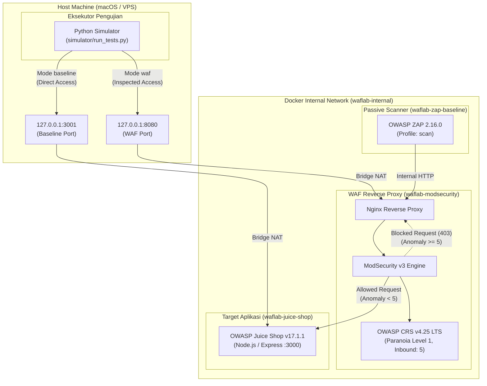

# Arsitektur WAF Research Lab

Dokumen ini mendefinisikan arsitektur sistem, topologi jaringan, spesifikasi container, dan batas keamanan untuk penelitian evaluasi Web Application Firewall (WAF) ModSecurity dan OWASP Core Rule Set (CRS) terhadap OWASP Juice Shop.

---

## 1. Topologi Komponen & Alur Jaringan



---

## 2. Alur Pengujian & Dua Jalur Komparasi

Untuk menjamin validitas metodologi penelitian ilmiah (*experimental research*), sistem menyediakan dua jalur request:

1. **Jalur Baseline (`http://127.0.0.1:3001`):**
   - Request langsung diteruskan ke OWASP Juice Shop tanpa perantara WAF.
   - Digunakan untuk mengukur:
     - Perilaku default aplikasi rentan terhadap serangan (ground truth baseline).
     - Latensi dasar respon aplikasi tanpa overhead WAF.
     - HTTP status alami aplikasi terhadap payload.

2. **Jalur WAF (`http://127.0.0.1:8080`):**
   - Request masuk ke Nginx reverse proxy, diinspeksi oleh engine ModSecurity dan dicocokkan dengan rule OWASP CRS.
   - Digunakan untuk mengukur:
     - Kemampuan deteksi (rule matching & anomaly scoring).
     - Kemampuan pemblokiran (HTTP 403 / connection drop).
     - Overhead latensi tambahan yang ditimbulkan oleh inspeksi WAF.

3. **Jalur Passive Scanner ZAP:**
   - Dijalankan terpisah dalam container Docker pada jaringan internal yang sama (`http://waf:8080`).
   - Bertujuan memetakan kerentanan secara pasif tanpa eksploitasi aktif.

---

## 3. Spesifikasi Service & Pinned Versions

Semua versi image di-pin secara eksplisit untuk menjamin reproduksibilitas:

| Service | Container Name | Base Image Tag | Healthcheck | Resource Limits |
|---|---|---|---|---|
| **juice-shop** | `waflab-juice-shop` | `bkimminich/juice-shop:v17.1.1` | Node.js HTTP ping ke port 3000 (`/`) | CPU 1.5, RAM 1024 MB |
| **waf** | `waflab-modsecurity` | `owasp/modsecurity-crs:4.25.2-nginx-alpine-lts` | Busybox `wget -q --spider` ke port 8080 | CPU 1.5, RAM 512 MB |
| **zap-baseline**| `waflab-zap-baseline`| `ghcr.io/zaproxy/zaproxy:2.16.0` | N/A (One-off task profile) | CPU 1.5, RAM 1024 MB |

---

## 4. Konfigurasi WAF & Core Rule Set

Konfigurasi lingkungan WAF disetel melalui environment variables:
* `BACKEND`: `http://juice-shop:3000` (target upstream internal)
* `PORT`: `8080` (listening port reverse proxy)
* `MODSEC_RULE_ENGINE`: `On` (enforcement mode aktif, request berbahaya diblokir dengan HTTP 403)
* `PARANOIA`: `1` (Paranoia Level 1 - CRS baseline untuk minimalisir false positive)
* `ANOMALY_INBOUND`: `5` (Threshold skor anomali inbound untuk memicu pemblokiran)
* `ANOMALY_OUTBOUND`: `4` (Threshold skor anomali outbound untuk kebocoran data)
* `MODSEC_AUDIT_ENGINE`: `RelevantOnly` (pencatatan log audit untuk request yang memicu intervensi/peringatan)

---

## 5. Perintah Operasional

### Menjalankan Lab
```bash
# Tarik image yang telah ter-pin
docker compose pull

# Jalankan service aplikasi dan WAF
docker compose up -d juice-shop waf

# Pantau status container dan healthcheck
docker compose ps
```

### Memeriksa Log Real-time
```bash
# Log gabungan
docker compose logs -f

# Log spesifik WAF (melihat rule CRS yang terpicu)
docker compose logs -f waf

# Log aplikasi Juice Shop
docker compose logs -f juice-shop
```

### Menghentikan dan Membersihkan Lab
```bash
# Hentikan container
docker compose down

# Hentikan dan hapus volume serta network jika reset total diperlukan
docker compose down -v
```
